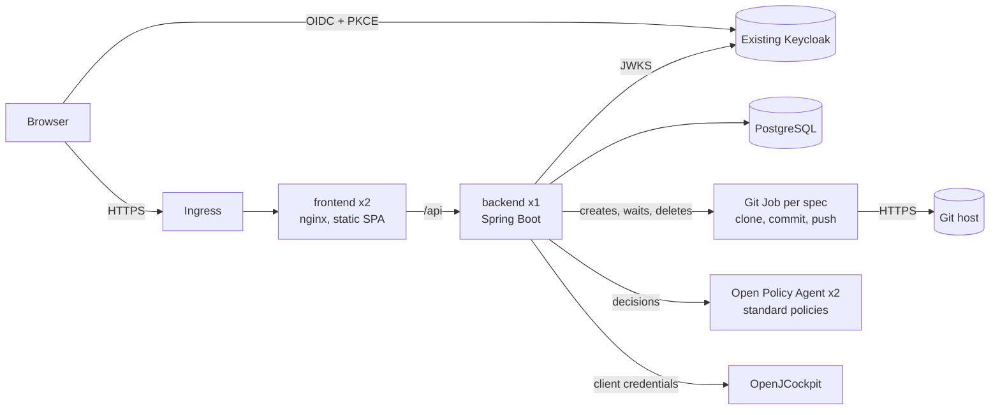

# Kubernetes deployment

This guide takes OpenJControlTower from container images to a working first run on a Kubernetes cluster. It is aimed at a **trusted team** evaluating the tool on real repositories. Read [PRODUCTION.md](PRODUCTION.md) for what remains before wider exposure.

## What gets deployed



| Resource | Notes |
|---|---|
| `Deployment/openjcontroltower-backend` | **1 replica**, `Recreate` strategy, UID 10001, read-only root FS, startup/liveness/readiness probes, Prometheus annotations |
| `Role` + `RoleBinding/openjcontroltower-git-jobs` | Lets the backend create, read and delete Jobs, create Secrets (never read them), list pods and read pod logs, in its own namespace only |
| `Job/ojct-git-<id>` | Created per approved spec, deleted when done: clones the repository, creates the branch `spec/<spec id>`, commits each file separately and pushes. Its inputs, including the Git credentials, are in a Secret owned by the Job, so Kubernetes deletes both together. `activeDeadlineSeconds` and `ttlSecondsAfterFinished` clean up after a backend crash |
| `Deployment/openjcontroltower-frontend` | 2 replicas, unprivileged nginx (UID 101), PodDisruptionBudget, runtime `config.js` and nginx config from ConfigMaps |
| `Deployment/openjcontroltower-opa` | *Component* `open-policy-agent` (enabled in the first-run overlay): 2 replicas, UID 65532, read-only root FS. The image contains the standard policies and their values; its REST API only allows reads and decisions. Sets `OPA_ENABLED=true` and `OPA_URL` on the backend |
| `Ingress/openjcontroltower` | Single host; the frontend proxies `/api` to the backend Service |
| `StatefulSet/openjcontroltower-postgres` | *Optional component* `bundled-postgres`: single instance, 10 Gi, for a first run only |
| `NetworkPolicy` ×5 | *Optional component* `network-policies` |

**Why only one backend replica?** Queue dispatch is serialized inside the JVM. Running two backends could dispatch the same spec twice. The `Recreate` strategy means a short downtime during upgrades (typically under 30 seconds). The backend keeps no files, and the frontend scales freely.

All workloads, including the Git Jobs, satisfy the **`restricted` Pod Security Standard**: the namespace in the overlay enforces it.

## Prerequisites

- Kubernetes **1.27+** and `kubectl` **1.27+**. Kustomize components are built into `kubectl`, so no Helm is needed.
- A default **StorageClass**, only if you use the `bundled-postgres` component.
- **Egress** to your Git host over HTTPS, from the Git Job pods and from the backend (for **Check connection**), and permission for the cluster to pull `alpine/git` (set `GIT_JOB_IMAGE` to a mirrored copy otherwise).
- An **Ingress controller**. The overlay assumes `ingressClassName: nginx`; change it if your cluster uses another one. Optional: [cert-manager](https://cert-manager.io/) for TLS.
- A **Keycloak** realm that you control (Keycloak is deliberately not part of these manifests).
- The two container images in a registry the cluster can pull from.

## 1. Publish the images

On every push to `main` and on `v*` tags, CI pushes to GHCR once all checks pass:

```text
ghcr.io/<github-owner>/openjcontroltower-backend:{main|<version>|sha-<commit>}
ghcr.io/<github-owner>/openjcontroltower-frontend:{main|<version>|sha-<commit>}
ghcr.io/<github-owner>/openjcontroltower-opa:{main|<version>|sha-<commit>}
```

GHCR packages are private by default. Either make them public, or create an image pull secret and add it to both ServiceAccounts.

To build and push manually instead:

```bash
docker build -t registry.example.org/openjcontroltower-backend:0.1.0 .
docker build -t registry.example.org/openjcontroltower-frontend:0.1.0 ./frontend
docker build -t registry.example.org/openjcontroltower-opa:0.1.0 ./infrastructure/opa
docker push registry.example.org/openjcontroltower-backend:0.1.0
docker push registry.example.org/openjcontroltower-frontend:0.1.0
docker push registry.example.org/openjcontroltower-opa:0.1.0
```

The frontend image is environment-neutral: it reads the Keycloak settings from the backend at runtime (with `/config.js` as fallback), so you do **not** need to rebuild it per cluster. The `opa` image does contain your policy values: rebuild it after changing `infrastructure/opa/policies/openjcontroltower/config/data.json`. For anything beyond a first run, pin a version tag or a digest rather than `main`.

## 2. Prepare Keycloak

In the realm you will use (for example `engineering`):

1. **Realm roles:** create `controltower-editor` and `controltower-admin`. Assign `controltower-editor` to the people who may register repositories, run interviews and approve specs. Assign `controltower-admin` only to the people who may change the Settings page (Keycloak instance and policy agent). Any authenticated user can read.
2. **Browser client** `openjcontroltower-web`:
   - Type: OpenID Connect, *Client authentication* **off** (public client), *Standard flow* on, every other flow off.
   - Advanced → *Proof Key for Code Exchange*: `S256`.
   - *Valid redirect URIs*: `https://controltower.example.org/*`
   - *Web origins*: `https://controltower.example.org`
3. **Service client** `openjcontroltower-service`, needed only once you enable dispatch:
   - Confidential client with *Service accounts roles* on.
   - Grant it whatever role or audience OpenJCockpit requires for its queue API. A shared realm does **not** grant that access by itself.

Note two values:

- **Issuer URI:** `https://<keycloak-host>/realms/<realm>`. It must equal the `iss` claim in the tokens browsers receive.
- **JWKS URI:** `<issuer>/protocol/openid-connect/certs`. It must be reachable from the backend pod. If Keycloak runs in the same cluster you can use its internal Service URL here, but keep the issuer external.

## 3. Configure the overlay

Copy the overlay, so that your environment's values live outside the shared example:

```bash
cp -R deploy/kubernetes/overlays/first-run deploy/kubernetes/overlays/my-cluster
cd deploy/kubernetes/overlays/my-cluster
cp secrets.env.example secrets.env
```

`secrets.env` is git-ignored. Edit every line marked `CHANGE ME`:

| File | Setting | Value |
|---|---|---|
| `kustomization.yaml` | `images[].newName` / `newTag` | Your registry, and a version tag (not `main`) once you go beyond a first run |
| `kustomization.yaml` | `KEYCLOAK_ISSUER_URI`, `KEYCLOAK_JWKS_URI`, `KEYCLOAK_CLIENT_ID` | From step 2. They are the defaults: administrators can change them later on the Settings page |
| `kustomization.yaml` | `COCKPIT_*` | OpenJCockpit URL and token endpoint; keep `COCKPIT_ENABLED=false` at first |
| `kustomization.yaml` | `GIT_AUTHOR_EMAIL` | E-mail address on the commits of spec branches |
| `kustomization.yaml` | Ingress patch | `ingressClassName`, host, TLS host; uncomment the cert-manager annotation if you use it |
| `config.js` | `keycloakUrl`, `keycloakRealm`, `keycloakClientId` | Fallback only, used when the backend cannot answer: Keycloak base URL (without `/realms/...`), realm, browser client ID |
| `secrets.env` | `DB_PASSWORD` | A long random value (`openssl rand -base64 32`) |
| `secrets.env` | `COCKPIT_CLIENT_SECRET` | Secret of the service client (any value while dispatch is disabled) |
| `secrets.env` | `OPENAI_API_KEY` | Keep `unused-in-demo-mode` while `AI_ENABLED=false` |
| `secrets.env` | `GIT_CREDENTIALS_SECRET`, `GIT_CREDENTIALS_SALT` | Key material that encrypts the Git tokens stored per repository: `openssl rand -base64 48` and `openssl rand -hex 16`. The backend refuses to start without them. Keep them safe: changing or losing them makes every stored token unreadable |

Repositories and their Git credentials are configured in the web interface (step 4), not in these files.

**Database:** the `bundled-postgres` component is fine for a first run. For anything you would mind losing, remove it from `components:` and add your managed PostgreSQL connection to the backend ConfigMap:

```yaml
      - DB_URL=jdbc:postgresql://postgres.example.org:5432/controltower?sslmode=require
      - DB_USER=controltower
```

The schema is created and upgraded automatically by Flyway on startup. The database user needs DDL rights on its schema.

Optional settings you can merge into `openjcontroltower-backend-config`:

- `AI_ENABLED=true`, `AI_MODEL=...`. Also put a real `OPENAI_API_KEY` in `secrets.env`.
- `DECISION_PROVIDER=laya|jev`. Also put `DECISION_API_KEY` in `secrets.env`.
- `API_DOCS_ENABLED=true` to expose Swagger UI.
- `HTTP_CONNECT_TIMEOUT` and `HTTP_READ_TIMEOUT`.
- `GIT_JOB_TIMEOUT` (default 90s), `GIT_JOB_IMAGE`, `GIT_BRANCH_PREFIX` (default `spec`) and `GIT_AUTHOR_NAME`. Approval waits for the push, so keep `GIT_JOB_TIMEOUT` below the proxy timeouts (120 s in the frontend nginx and the Ingress annotation).
- `CONTROLTOWER_EDITOR_ROLE` and `CONTROLTOWER_ADMIN_ROLE`, if your realm uses other role names. Also update `writer_roles` and `dispatch_roles` in the policy data.
- `OPA_FAIL_OPEN=true` to allow governed actions while the agent is down (default: denied). Remove the `open-policy-agent` component to run without policies.

**Policies:** the standard policy values are in `infrastructure/opa/policies/openjcontroltower/config/data.json`. For a cluster, set at least `allowed_git_hosts` to your Git hosts, and consider `require_four_eyes: true`. Then rebuild and publish the `opa` image.

## 4. Deploy and verify

```bash
kubectl kustomize deploy/kubernetes/overlays/my-cluster | less   # review what will be applied
kubectl apply -k deploy/kubernetes/overlays/my-cluster

kubectl -n openjcontroltower rollout status statefulset/openjcontroltower-postgres
kubectl -n openjcontroltower rollout status deploy/openjcontroltower-backend --timeout=5m
kubectl -n openjcontroltower rollout status deploy/openjcontroltower-frontend
kubectl -n openjcontroltower get pods,ingress
```

Checks:

```bash
# Flyway migration and startup
kubectl -n openjcontroltower logs deploy/openjcontroltower-backend | grep -E 'migration|Started'
# The API answers 401 without a token, through the frontend proxy
curl -s -o /dev/null -w '%{http_code}\n' https://controltower.example.org/api/projects
```

Then open `https://controltower.example.org`, sign in with a user that has `controltower-editor`, and connect a repository under **Repositories**: its HTTPS clone URL, base branch and credentials.

## 5. Spec branches

Approving a spec starts a Job that clones the base branch, creates `spec/<spec id>`, commits `spec.md`, `plan.md`, `tasks.md`, `review.md` and the `specs/_index.md` update as five separate commits, and pushes. The approval returns once the push is done, and the spec shows its branch. Then the Job and its Secret are deleted.

**Credentials:** use a token with write access to the repository contents, for example a GitHub fine-grained token or a GitLab project access token. The token is encrypted in the database (AES-256-GCM), is never returned by the API, and only reaches the Job through its Secret. Leave the username empty for tokens: `token` is used.

Watch a running job:

```bash
kubectl -n openjcontroltower get jobs,pods -l app.kubernetes.io/component=git-job
kubectl -n openjcontroltower logs -l app.kubernetes.io/component=git-job --tail=50
```

OpenJCockpit reads specs from the repository's branch, not from spec branches. **Merge each spec branch** (for example through a pull request) before you confirm the merge in the queue screen and dispatch.

## 6. Enable OpenJCockpit dispatch

1. Make sure the service client from step 2 is authorized by OpenJCockpit.
2. Set `COCKPIT_ENABLED=true` in the overlay, and the real `COCKPIT_CLIENT_SECRET` in `secrets.env`.
3. Run `kubectl apply -k` again. The ConfigMap and Secret names are content-hashed, so the backend restarts automatically with the new values.

A dispatch whose outcome is unknown (timeout or transport failure) is recorded as `UNKNOWN` and **never retried automatically**. Check OpenJCockpit before doing anything else.

## Operations

### Health and metrics

| Endpoint (backend port 8080) | Used by |
|---|---|
| `/actuator/health/liveness` | startup and liveness probes |
| `/actuator/health/readiness` | readiness probe; includes the database check |
| `/actuator/prometheus` | Prometheus; the pod carries `prometheus.io/*` annotations |

These endpoints are unauthenticated but are **not** routed through the Ingress. The frontend only proxies `/api`. If you enable the `network-policies` component and scrape from another namespace, add an ingress rule for your Prometheus namespace to `NetworkPolicy/openjcontroltower-backend`.

### Logs

The backend writes ECS-formatted JSON to stdout (`LOGGING_STRUCTURED_FORMAT_CONSOLE=ecs`). Set it to `logstash`, or to an empty value for plain text.

### Upgrades and rollback

- Update `newTag` (or digest) and run `kubectl apply -k` again. Flyway applies new migrations before the application reports ready.
- Migrations are **forward-only**. Back up the database before an upgrade (see below). A rollback to an older image works only if the schema is still compatible with it.
- To roll back the image: `kubectl -n openjcontroltower rollout undo deploy/openjcontroltower-backend`.

### Backups

```bash
# Bundled PostgreSQL: logical dump
kubectl -n openjcontroltower exec statefulset/openjcontroltower-postgres -- \
  pg_dump -U controltower -d controltower --format=custom > controltower-$(date +%F).dump
# Restore into an empty database
kubectl -n openjcontroltower exec -i statefulset/openjcontroltower-postgres -- \
  pg_restore -U controltower -d controltower --clean --if-exists < controltower-YYYY-MM-DD.dump
```

Spec files live in their Git repositories, so the database is the only state to back up. Keep `GIT_CREDENTIALS_SECRET` and `GIT_CREDENTIALS_SALT` with the backup: without them the stored Git tokens cannot be decrypted. Run a restore test at least once.

### Resource sizing

| Container | Requests | Memory limit |
|---|---|---|
| backend | 250m CPU / 768 Mi | 1 Gi (JVM heap = 75% of it) |
| Git job | 100m CPU / 128 Mi | 512 Mi |
| frontend | 25m CPU / 32 Mi | 128 Mi |
| postgres | 100m CPU / 256 Mi | 512 Mi |

No CPU limits are set, to avoid JVM throttling. Adjust these in a patch after watching real usage.

## Troubleshooting

| Symptom | Likely cause / fix |
|---|---|
| Backend `CrashLoopBackOff` with `GIT_CREDENTIALS_SECRET must be at least 32 characters` or `GIT_CREDENTIALS_SALT ...` | Set both in `secrets.env`; the salt must be hexadecimal. |
| **Check connection** says `Could not connect to <host>` | The backend pod cannot reach the Git host: DNS, egress policy or proxy. |
| Approval fails with `Authentication failed` | Wrong token or username, or the token lacks write access. Edit the repository and enter the token again. |
| Approval fails with `Branch spec/... already exists on the remote` | An earlier attempt already pushed it. Delete the remote branch, or keep it and treat the spec as published. |
| Approval fails with `did not finish within 90 seconds` | The Job pod could not start (image pull, Pod Security, quota) or the Git host is unreachable. Run `kubectl describe` on the Job's pod. |
| Approval fails with `403` from the Kubernetes API | The Role or RoleBinding is missing, or the backend pod has no service account token (`automountServiceAccountToken: true`). |
| PVC stays `Pending` | No default StorageClass for the bundled PostgreSQL. Set `storageClassName` with a patch. |
| Backend not ready, readiness `DOWN` | Database unreachable or wrong credentials. Check `DB_URL` and `DB_PASSWORD`, and the postgres pod. |
| Actions fail with `Denied by policy: ...` | A standard policy refused it; the message names the rule. Change its value in the policy data, or ask an administrator. |
| Actions fail with `Open Policy Agent could not be reached` | The `openjcontroltower-opa` pods are down or unreachable (network policy). Check `kubectl get pods -l app.kubernetes.io/component=opa`. Policies fail closed by default. |
| Everyone is locked out after a Keycloak change on the Settings page | A setting the signing-key check cannot catch, such as a wrong client ID. Merge `KEYCLOAK_IGNORE_SAVED_SETTINGS=true` into the backend ConfigMap, restart the backend, sign in, fix the settings, and remove the variable again. |
| Every API call returns `401` after login | `KEYCLOAK_ISSUER_URI` differs from the token's `iss` claim (scheme, host and realm must match exactly), or the JWKS URI is unreachable from the pod. |
| API returns `403` on writes | The user lacks the `controltower-editor` realm role, or the role names differ. Set `CONTROLTOWER_EDITOR_ROLE`. |
| Login page loops or "Keycloak login error" | The Keycloak settings are wrong (Settings page, or `KEYCLOAK_*` before anything was saved), or the redirect URI / web origin is missing in the Keycloak client. |
| Frontend `CrashLoopBackOff` with `host not found in upstream` | The backend Service is missing or renamed. Don't use `namePrefix`/`nameSuffix` in the overlay, because the nginx config refers to `openjcontroltower-backend`. |
| `Git URL must start with https://` | Only HTTPS clone URLs are supported; SSH URLs (`git@...`) are not. |
| Pods rejected with `violates PodSecurity "restricted"` | A local patch added a privileged setting. Revert it, or relax the namespace label consciously. |

## Verification status

- The manifests are rendered in CI (`kubernetes-manifests` job) with `kubectl kustomize`, with and without the network policies.
- Before release, the containers were run locally under the same constraints the manifests impose:
  - UID 10001 / 101
  - read-only root filesystem with a tmpfs `/tmp`
  - all capabilities dropped
  - the Kubernetes nginx config and `config.js` mounted read-only
  - PostgreSQL 17 under the Service DNS names
- That run checked:
  - Flyway migrated the database
  - liveness and readiness reported `UP`
  - Prometheus metrics were served
  - the frontend served the SPA and `config.js` with `no-store`
  - `/api` was proxied to the backend, which answered `401` without a token
- The Kubernetes Git runner is unit-tested against a simulated Kubernetes API (Job spec, owned Secret, polling, logs, deletion, timeouts). The Job itself runs the same script that the browser end-to-end tests run in Docker against a real Git server. It has **not** yet run on a real cluster.
- An end-to-end run on a real cluster, with a real Keycloak login and a spec approval, is the **first-run step this guide is for**. Please report issues.
