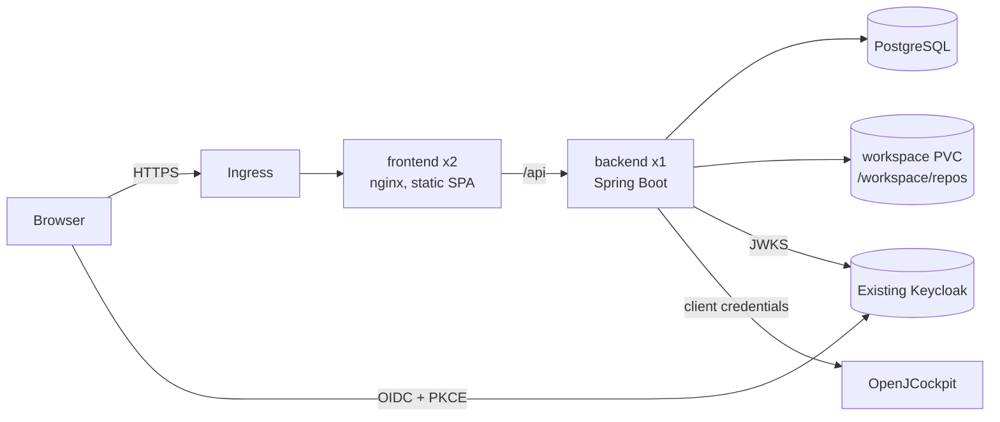

# Kubernetes deployment

This guide takes OpenJControlTower from container images to a working first run on a Kubernetes cluster. It is aimed at a **trusted team** evaluating the tool on real repositories. Read [PRODUCTION.md](PRODUCTION.md) for what remains before wider exposure.

## What gets deployed



| Resource | Notes |
|---|---|
| `Deployment/openjcontroltower-backend` | **1 replica**, `Recreate` strategy, UID 10001, read-only root FS, startup/liveness/readiness probes, Prometheus annotations |
| `PersistentVolumeClaim/openjcontroltower-workspace` | 5 Gi `ReadWriteOnce` volume holding the Git working copies that specs are written into |
| `Deployment/openjcontroltower-frontend` | 2 replicas, unprivileged nginx (UID 101), PodDisruptionBudget, runtime `config.js` and nginx config from ConfigMaps |
| `Ingress/openjcontroltower` | Single host; the frontend proxies `/api` to the backend Service |
| `StatefulSet/openjcontroltower-postgres` | *Optional component* `bundled-postgres`: single instance, 10 Gi, for a first run only |
| init container `workspace-seed` | *Optional component*: clones the repositories listed in a Secret, never overwrites existing ones |
| `NetworkPolicy` ×3 | *Optional component* `network-policies` |

**Why only one backend replica?** Spec publication and queue dispatch are serialized inside the JVM, and the workspace is a `ReadWriteOnce` volume. Running two backends could interleave writes to `specs/_index.md` or dispatch the same spec twice. The `Recreate` strategy means a short downtime during upgrades (typically under 30 seconds). The frontend scales freely.

All workloads satisfy the **`restricted` Pod Security Standard**: the namespace in the overlay enforces it.

## Prerequisites

- Kubernetes **1.27+** and `kubectl` **1.27+**. Kustomize components are built into `kubectl`, so no Helm is needed.
- A default **StorageClass** that provisions `ReadWriteOnce` volumes.
- An **Ingress controller**. The overlay assumes `ingressClassName: nginx`; change it if your cluster uses another one. Optional: [cert-manager](https://cert-manager.io/) for TLS.
- A **Keycloak** realm that you control (Keycloak is deliberately not part of these manifests).
- The two container images in a registry the cluster can pull from.

## 1. Publish the images

On every push to `main` and on `v*` tags, CI pushes to GHCR once all checks pass:

```text
ghcr.io/<github-owner>/openjcontroltower-backend:{main|<version>|sha-<commit>}
ghcr.io/<github-owner>/openjcontroltower-frontend:{main|<version>|sha-<commit>}
```

GHCR packages are private by default. Either make them public, or create an image pull secret and add it to both ServiceAccounts.

To build and push manually instead:

```bash
docker build -t registry.example.org/openjcontroltower-backend:0.1.0 .
docker build -t registry.example.org/openjcontroltower-frontend:0.1.0 ./frontend
docker push registry.example.org/openjcontroltower-backend:0.1.0
docker push registry.example.org/openjcontroltower-frontend:0.1.0
```

The frontend image is environment-neutral: Keycloak settings are read at runtime from `/config.js`, so you do **not** need to rebuild it per cluster. For anything beyond a first run, pin a version tag or a digest rather than `main`.

## 2. Prepare Keycloak

In the realm you will use (for example `engineering`):

1. **Realm roles:** create `controltower-editor` and `controltower-admin`. Assign `controltower-editor` to the people who may register repositories, run interviews and approve specs. Any authenticated user can read.
2. **Browser client** `openjcontroltower-web`:
   - Type: OpenID Connect, *Client authentication* **off** (public client), *Standard flow* on, every other flow off.
   - Advanced → *Proof Key for Code Exchange*: `S256`.
   - *Valid redirect URIs*: `https://controltower.example.org/*`
   - *Web origins*: `https://controltower.example.org`
3. **Service client** `openjcontroltower-service`, needed only once you enable dispatch:
   - Confidential client with *Service accounts roles* on.
   - Grant it whatever role or audience OpenJCockpit requires for its queue API. A shared realm does **not** grant that access by itself.

Note two values:

- **Issuer URI:** `https://<keycloak-host>/realms/<realm>`. It must equal the `iss` claim in the tokens browsers receive.
- **JWKS URI:** `<issuer>/protocol/openid-connect/certs`. It must be reachable from the backend pod. If Keycloak runs in the same cluster you can use its internal Service URL here, but keep the issuer external.

## 3. Configure the overlay

Copy the overlay, so that your environment's values live outside the shared example:

```bash
cp -R deploy/kubernetes/overlays/first-run deploy/kubernetes/overlays/my-cluster
cd deploy/kubernetes/overlays/my-cluster
cp secrets.env.example secrets.env
cp repositories.txt.example repositories.txt
```

`secrets.env` and `repositories.txt` are git-ignored. Edit every line marked `CHANGE ME`:

| File | Setting | Value |
|---|---|---|
| `kustomization.yaml` | `images[].newName` / `newTag` | Your registry, and a version tag (not `main`) once you go beyond a first run |
| `kustomization.yaml` | `KEYCLOAK_ISSUER_URI`, `KEYCLOAK_JWKS_URI` | From step 2 |
| `kustomization.yaml` | `COCKPIT_*` | OpenJCockpit URL and token endpoint; keep `COCKPIT_ENABLED=false` at first |
| `kustomization.yaml` | Ingress patch | `ingressClassName`, host, TLS host; uncomment the cert-manager annotation if you use it |
| `config.js` | `keycloakUrl`, `keycloakRealm`, `keycloakClientId` | Keycloak base URL (without `/realms/...`), realm, browser client ID |
| `secrets.env` | `DB_PASSWORD` | A long random value (`openssl rand -base64 32`) |
| `secrets.env` | `COCKPIT_CLIENT_SECRET` | Secret of the service client (any value while dispatch is disabled) |
| `secrets.env` | `OPENAI_API_KEY` | Keep `unused-in-demo-mode` while `AI_ENABLED=false` |
| `repositories.txt` | `<name> <clone-url>` lines | Repositories to clone into `/workspace/repos/<name>` |

For private repositories, embed a deploy token with **write** access in the clone URL, so the same remote can be used to push generated specs. For example: `https://x-access-token:<token>@github.com/org/repo.git`. The URL is stored in a Secret and never logged.

**Database:** the `bundled-postgres` component is fine for a first run. For anything you would mind losing, remove it from `components:` and add your managed PostgreSQL connection to the backend ConfigMap:

```yaml
      - DB_URL=jdbc:postgresql://postgres.example.org:5432/controltower?sslmode=require
      - DB_USER=controltower
```

The schema is created and upgraded automatically by Flyway on startup. The database user needs DDL rights on its schema.

Optional settings you can merge into `openjcontroltower-backend-config`:

- `AI_ENABLED=true`, `AI_MODEL=...`. Also put a real `OPENAI_API_KEY` in `secrets.env`.
- `DECISION_PROVIDER=laya|jev`. Also put `DECISION_API_KEY` in `secrets.env`.
- `API_DOCS_ENABLED=true` to expose Swagger UI.
- `HTTP_CONNECT_TIMEOUT` and `HTTP_READ_TIMEOUT`.
- `CONTROLTOWER_EDITOR_ROLE` and `CONTROLTOWER_ADMIN_ROLE`, if your realm uses other role names.

## 4. Deploy and verify

```bash
kubectl kustomize deploy/kubernetes/overlays/my-cluster | less   # review what will be applied
kubectl apply -k deploy/kubernetes/overlays/my-cluster

kubectl -n openjcontroltower rollout status statefulset/openjcontroltower-postgres
kubectl -n openjcontroltower rollout status deploy/openjcontroltower-backend --timeout=5m
kubectl -n openjcontroltower rollout status deploy/openjcontroltower-frontend
kubectl -n openjcontroltower get pods,pvc,ingress
```

Checks:

```bash
# Repositories cloned by the init container
kubectl -n openjcontroltower logs deploy/openjcontroltower-backend -c workspace-seed
# Flyway migration and startup
kubectl -n openjcontroltower logs deploy/openjcontroltower-backend | grep -E 'migration|Started'
# The API answers 401 without a token, through the frontend proxy
curl -s -o /dev/null -w '%{http_code}\n' https://controltower.example.org/api/projects
```

Then open `https://controltower.example.org`, sign in with a user that has `controltower-editor`, and register the repository as **`/workspace/repos/<name>`**, using the name from `repositories.txt`.

## 5. Commit and push generated specs

Approved specs are written to `/workspace/repos/<name>/specs/` on the volume. Nothing is committed or pushed automatically (roadmap item CT-0001). The backend image ships `git`, so you can do this from the pod:

```bash
NS=openjcontroltower; REPO=/workspace/repos/example
kubectl -n $NS exec deploy/openjcontroltower-backend -- git -C $REPO status --short
kubectl -n $NS exec deploy/openjcontroltower-backend -- git -C $REPO \
  -c user.name="Control Tower" -c user.email="controltower@example.org" \
  commit -m "Add approved specs" -- specs
kubectl -n $NS exec deploy/openjcontroltower-backend -- git -C $REPO push
```

Only after the push is visible to OpenJCockpit should you confirm *repository published* in the queue screen and dispatch.

## 6. Enable OpenJCockpit dispatch

1. Make sure the service client from step 2 is authorized by OpenJCockpit.
2. Set `COCKPIT_ENABLED=true` in the overlay, and the real `COCKPIT_CLIENT_SECRET` in `secrets.env`.
3. Run `kubectl apply -k` again. The ConfigMap and Secret names are content-hashed, so the backend restarts automatically with the new values.

A dispatch whose outcome is unknown (timeout or transport failure) is recorded as `UNKNOWN` and **never retried automatically**. Check OpenJCockpit before doing anything else.

## Operations

### Health and metrics

| Endpoint (backend port 8080) | Used by |
|---|---|
| `/actuator/health/liveness` | startup and liveness probes |
| `/actuator/health/readiness` | readiness probe; includes the database check |
| `/actuator/prometheus` | Prometheus; the pod carries `prometheus.io/*` annotations |

These endpoints are unauthenticated but are **not** routed through the Ingress. The frontend only proxies `/api`. If you enable the `network-policies` component and scrape from another namespace, add an ingress rule for your Prometheus namespace to `NetworkPolicy/openjcontroltower-backend`.

### Logs

The backend writes ECS-formatted JSON to stdout (`LOGGING_STRUCTURED_FORMAT_CONSOLE=ecs`). Set it to `logstash`, or to an empty value for plain text.

### Upgrades and rollback

- Update `newTag` (or digest) and run `kubectl apply -k` again. Flyway applies new migrations before the application reports ready.
- Migrations are **forward-only**. Back up the database before an upgrade (see below). A rollback to an older image works only if the schema is still compatible with it.
- To roll back the image: `kubectl -n openjcontroltower rollout undo deploy/openjcontroltower-backend`.

### Backups

```bash
# Bundled PostgreSQL: logical dump
kubectl -n openjcontroltower exec statefulset/openjcontroltower-postgres -- \
  pg_dump -U controltower -d controltower --format=custom > controltower-$(date +%F).dump
# Restore into an empty database
kubectl -n openjcontroltower exec -i statefulset/openjcontroltower-postgres -- \
  pg_restore -U controltower -d controltower --clean --if-exists < controltower-YYYY-MM-DD.dump
```

The workspace volume holds Git working copies. Pushing specs to their remote, as in step 5, is the primary backup. Volume snapshots (CSI `VolumeSnapshot`) are a useful extra. Run a restore test at least once.

### Resource sizing

| Container | Requests | Memory limit |
|---|---|---|
| backend | 250m CPU / 768 Mi | 1 Gi (JVM heap = 75% of it) |
| frontend | 25m CPU / 32 Mi | 128 Mi |
| postgres | 100m CPU / 256 Mi | 512 Mi |

No CPU limits are set, to avoid JVM throttling. Adjust these in a patch after watching real usage.

## Troubleshooting

| Symptom | Likely cause / fix |
|---|---|
| Backend `Init:CrashLoopBackOff` | `workspace-seed` cannot clone. Run `kubectl logs ... -c workspace-seed`, then check the URL, token and egress to the Git host. |
| PVC stays `Pending` | No default StorageClass. Set `storageClassName` with a patch. |
| Backend not ready, readiness `DOWN` | Database unreachable or wrong credentials. Check `DB_URL` and `DB_PASSWORD`, and the postgres pod. |
| Every API call returns `401` after login | `KEYCLOAK_ISSUER_URI` differs from the token's `iss` claim (scheme, host and realm must match exactly), or the JWKS URI is unreachable from the pod. |
| API returns `403` on writes | The user lacks the `controltower-editor` realm role, or the role names differ. Set `CONTROLTOWER_EDITOR_ROLE`. |
| Login page loops or "Keycloak login error" | `config.js` values are wrong, or the redirect URI / web origin is missing in the Keycloak client. |
| Frontend `CrashLoopBackOff` with `host not found in upstream` | The backend Service is missing or renamed. Don't use `namePrefix`/`nameSuffix` in the overlay, because the nginx config refers to `openjcontroltower-backend`. |
| `Repository must be inside the configured workspace` | Register the path as `/workspace/repos/<name>`, and make sure that directory contains `.git`. |
| Pods rejected with `violates PodSecurity "restricted"` | A local patch added a privileged setting. Revert it, or relax the namespace label consciously. |

## Verification status

- The manifests are rendered in CI (`kubernetes-manifests` job) with `kubectl kustomize`, with and without the network policies.
- Before release, the containers were run locally under the same constraints the manifests impose:
  - UID 10001 / 101
  - read-only root filesystem with a tmpfs `/tmp`
  - all capabilities dropped
  - the Kubernetes nginx config and `config.js` mounted read-only
  - PostgreSQL 17 under the Service DNS names
- That run checked:
  - the seed init script cloned a repository
  - Flyway migrated the database
  - liveness and readiness reported `UP`
  - Prometheus metrics were served
  - the frontend served the SPA and `config.js` with `no-store`
  - `/api` was proxied to the backend, which answered `401` without a token
- An end-to-end run on a real cluster, with a real Keycloak login, is the **first-run step this guide is for**. Please report issues.
